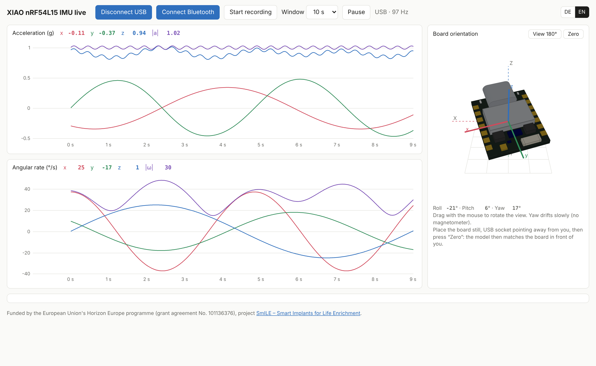

# XIAO nRF54L15 Sense – IMU live

[](LICENSE)
[](https://wiki.seeedstudio.com/xiao_nrf54l15_sense_getting_started/)
[](https://platformio.org)

Firmware and a browser app that read the 6-axis IMU (LSM6DS3TR-C) of the **Seeed Studio XIAO nRF54L15 Sense** at 100 Hz and show it live: acceleration, angular rate and a 3D view of the board orientation. Data comes in via **Bluetooth LE** or **USB serial**, and can be recorded to CSV.

**Web app:** <https://soylentorange.github.io/XIAO_IMU_Live/> (Chrome or Edge on desktop and Android, installable as an app)

<p align="center">
  
</p>

---

## Table of Contents

1. [Overview](#overview)
2. [Firmware](#firmware)
   - [Building and Flashing](#building-and-flashing)
   - [Data Formats](#data-formats)
3. [Web App](#web-app)
   - [Features](#features)
   - [Browser Support](#browser-support)
   - [Install on Android](#install-on-android)
   - [Hosting on GitHub Pages](#hosting-on-github-pages)
4. [Repository Layout](#repository-layout)
5. [Acknowledgements & Funding](#acknowledgements--funding)
6. [License](#license)

---

## Overview

- **Sensor:** LSM6DS3TR-C on the XIAO nRF54L15 Sense (I²C, Zephyr driver `lsm6dsl`), ±16 g and ±2000 °/s, internal rate 208 Hz, output 100 Hz.
- **Firmware:** Zephyr 4.2 via PlatformIO. Streams every sample over USB serial (CSV) and over BLE notifications at the same time.
- **Web app:** a single HTML file without external dependencies. Uses Web Bluetooth and Web Serial, a Madgwick filter for orientation, and a small 3D model derived from the Seeed STEP model.

## Firmware

### Building and Flashing

Requirements: [PlatformIO](https://platformio.org) (e.g. the VS Code extension). The Seeed platform is fetched automatically.

```bash
pio run -t upload        # build and flash via the on-board CMSIS-DAP probe
pio device monitor       # optional: show the CSV stream (115200 baud)
```

Settings such as sample rate and ranges are at the top of [`src/main.c`](src/main.c):

| Constant | Default | Meaning |
|---|---|---|
| `SAMPLE_RATE_HZ` | 100 | Output rate |
| `IMU_ODR_HZ` | 208 | Internal sensor rate |
| `ACCEL_RANGE_G` | 16 | ±2, 4, 8 or 16 g |
| `GYRO_RANGE_DPS` | 2000 | ±245, 500, 1000 or 2000 °/s |
| `BLE_BATCH` | 5 | Samples per BLE notification (20 packets/s) |
| `SERIAL_BATCH` | 2 | Lines per serial burst (see below) |

The LED blinks slowly while advertising and fast while a BLE client is connected.

> [!NOTE]
> The USB-serial bridge on the XIAO only forwards data immediately when the line is idle for more than about 10 ms. A steady 100 lines/s would otherwise be buffered in 16 KiB blocks (about 4 s delay). The firmware therefore sends two lines every 20 ms.

### Data Formats

**USB serial** (115200 baud), one line per sample; lines starting with `#` are comments:

```text
t_ms,ax_g,ay_g,az_g,gx_dps,gy_dps,gz_dps
123450,0.012,-0.004,1.001,0.3,-0.1,0.0
```

**Bluetooth LE:** device name `XIAO-IMU`

- Service `7a1e0001-5c3b-4f0a-9d2e-3c8f1b6a4d01`
- Characteristic `7a1e0002-5c3b-4f0a-9d2e-3c8f1b6a4d01` (notify)

Each notification (little endian):

| Field | Type | Content |
|---|---|---|
| `t_ms` | uint32 | Timestamp of the first sample in the packet |
| `n` | uint8 | Number of samples, 10 ms apart |
| samples | n × 6 × int16 | ax, ay, az in mg; gx, gy, gz in 0.1 °/s |

**CSV recordings** from the web app use the same columns as the serial output.

## Web App

The app lives in [`docs/index.html`](docs/index.html). It can be opened directly from disk (USB and BLE work in Chrome/Edge on desktop) or served via GitHub Pages.

### Features

- Connect via **Bluetooth LE** or **USB serial**
- Live plots of acceleration and angular rate including the magnitudes |a| and |ω|, window 5 / 10 / 30 s
- **3D orientation** view (Madgwick filter, accelerometer + gyroscope) with a model of the board, drag with mouse or finger to rotate the camera, "Zero" to reset orientation and gyro offset
- **CSV recording** and download
- German and English (switch in the top right corner)
- Works offline after the first visit and can be installed as an app (PWA)

Yaw drifts slowly because the board has no magnetometer.

### Browser Support

| | Bluetooth LE | USB serial |
|---|---|---|
| Chrome / Edge on macOS, Windows, Linux | yes | yes |
| Chrome on Android | yes | no |
| Brave | after enabling `brave://flags/#brave-web-bluetooth-api` | yes |
| Safari, Firefox, iOS | no | no |

Web Bluetooth and Web Serial need a secure context: `https://` (e.g. GitHub Pages), `localhost`, or a file opened from disk.

### Install on Android

1. Open the [web app](https://soylentorange.github.io/XIAO_IMU_Live/) in Chrome.
2. Menu ⋮ → **Add to Home screen** → **Install**.
3. Start "IMU live" from the home screen, tap **Connect Bluetooth** and choose `XIAO-IMU`. Android asks for the "Nearby devices" permission the first time.

### Hosting on GitHub Pages

1. On GitHub: **Settings → Pages**.
2. Under **Build and deployment** choose **Deploy from a branch**, branch `main`, folder **`/docs`**, then **Save**.
3. After a minute the app is available at `https://<user>.github.io/<repository>/`.

When you change the app, increase `VERSION` in [`docs/sw.js`](docs/sw.js) so installed copies pick up the new files.

## Repository Layout

```text
platformio.ini          PlatformIO project (board seeed-xiao-nrf54l15, Zephyr)
src/main.c              Firmware: IMU readout, serial CSV, BLE GATT service
zephyr/prj.conf         Zephyr configuration (I²C, sensor, BLE)
zephyr/CMakeLists.txt
docs/index.html         Web app (single file)
docs/manifest.webmanifest, docs/sw.js, docs/icons/   PWA files
docs/assets/            Logos and screenshot
```

---

## Acknowledgements & Funding

This project has received funding from the European Union's Horizon Europe research and innovation programme under grant agreement No. **101136376** ([**SmILE** – *Smart Implants for Life Enrichment*](https://horizon-smile.eu/)).

<p align="left">
  <a href="https://horizon-smile.eu/">
    
  </a>
  &nbsp;&nbsp;&nbsp;&nbsp;
  <a href="https://commission.europa.eu">
    
  </a>
</p>

* **Project Website:** [https://horizon-smile.eu/](https://horizon-smile.eu/)

*Disclaimer:* Funded by the European Union. Views and opinions expressed are however those of the author(s) only and do not necessarily reflect those of the European Union or the European Health and Digital Executive Agency (HADEA). Neither the European Union nor the granting authority can be held responsible for them.

The simplified 3D board model is derived from the Seeed Studio XIAO nRF54L15 STEP model ([GrabCAD](https://grabcad.com/library/seeed-studio-xiao-nrf54l15-sense-1)).

---

## License

This project is licensed under the **MIT License** ([MIT](LICENSE)).
For details, please refer to the [LICENSE](LICENSE) file.
